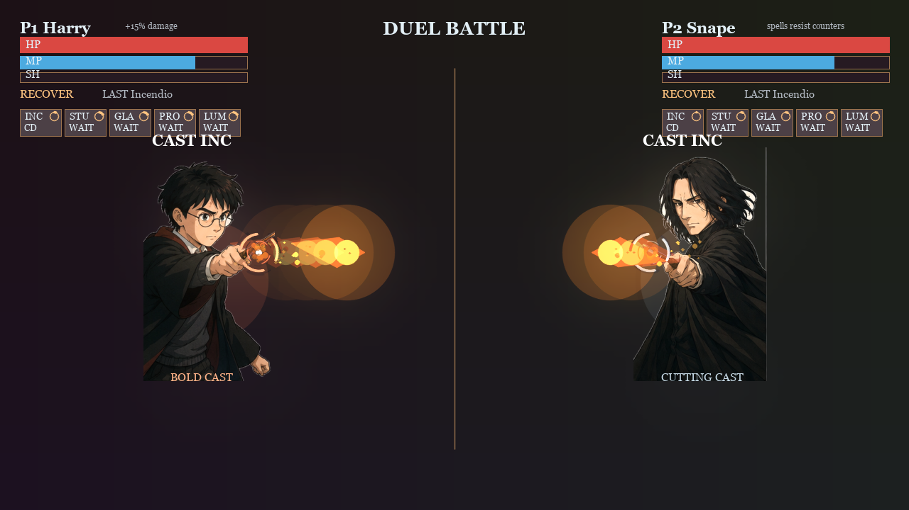

# Spells Battle

用手指画一道轨迹，或者挥动带彩色标记的魔杖尖，把动作变成屏幕上的咒语。

Spells Battle 是一个 Python 桌面魔法对战游戏。你可以先用键盘练习施法，再接入摄像头体验轨迹识别；既能在同一台电脑上双人对战，也能通过房间码连接两台电脑。战斗包含生命值、法力、护盾、冷却和咒语碰撞。



上图截自游戏主循环：无摄像头背景、本地双人模式，使用模拟按键施法。角色、HUD 和弹道均由当前游戏代码渲染。

[下载 ZIP](https://github.com/Q1uP1nG/spells-battle/archive/refs/heads/main.zip) · [安装与启动](#安装与启动) · [玩法与操作](#玩法与操作) · [远程对战](#远程对战) · [常见问题](#常见问题)

## 先了解怎么玩

| 菜单 | 模式 | 适合做什么 |
| --- | --- | --- |
| `1` | Solo Showcase | 对训练假人练习咒语、键盘和视觉输入 |
| `2` | Duel Battle | 两人在同一台电脑上对战，P1 在左、P2 在右 |
| `3` | PVE Battle | 与规则驱动的电脑对手对战 |
| `4` | CV Bank | 浏览、重录和维护手势模板槽位 |
| `5` | Remote Duel | 两台电脑通过房间码进行对战 |

角色原图、透明角色图、音效、手部识别模型和手势模板都随仓库提供。下载后需要安装 Python 和依赖，再启动桌面客户端。单机模式不需要连接对战服务器；没有摄像头也可以使用键盘游玩。

## 安装与启动

### 环境要求

- 推荐先使用 Windows 和 Python 3.13；已验证的 Python 版本为 **3.13.13**。
- 需要能打开桌面图形窗口的环境。SSH 终端或没有桌面的服务器用于运行对战服务端。
- 首次安装依赖需要联网。视觉输入需要摄像头，键盘输入不需要。
- macOS / Linux 命令见下方，当前未完成这两个平台的运行验证。

### 1. 下载项目

点击[下载 ZIP](https://github.com/Q1uP1nG/spells-battle/archive/refs/heads/main.zip)并解压，进入包含 `main.py` 和 `requirements.txt` 的文件夹。

也可以使用 Git：

```bash
git clone https://github.com/Q1uP1nG/spells-battle.git
cd spells-battle
```

### 2. 安装依赖并运行

在项目文件夹中打开 PowerShell，执行：

```powershell
python -m venv .venv
.\.venv\Scripts\python.exe -m pip install -r requirements.txt
.\.venv\Scripts\python.exe main.py
```

如果找不到 `python`，但已安装 Windows Python 启动器，可以把第一条命令换成 `py -3.13 -m venv .venv`。后两条命令保持不变。这里直接调用虚拟环境中的 Python，无需执行激活脚本。

以后打开游戏，只需在项目文件夹执行：

```powershell
.\.venv\Scripts\python.exe main.py
```

<details>
<summary>macOS / Linux 启动命令（尚未完成平台验证）</summary>

需要先安装带有 `venv` 支持的 Python，并确保 OpenCV 可以在系统上打开图形窗口。

```bash
python3 -m venv .venv
.venv/bin/python -m pip install -r requirements.txt
.venv/bin/python main.py
```

下文 Windows 命令中的 `.\.venv\Scripts\python.exe`，在这些平台上换成 `.venv/bin/python`。

</details>

### 3. 开始第一局

1. 点击游戏窗口，并切换到英文输入法。
2. 在说明页按空格进入菜单。先按 `1` 练习，或按 `3` 进入 PVE。
3. 本地双人和 PVE 会先进入角色选择。P1 用 `A` / `F` 换角色，空格或回车确认；本地双人的 P2 用 `J` / `K` 换角色。
4. PVE 确认角色后，再按空格开始。P1 可用 `Q` / `W` / `E` / `R` / `T` 施法。

## 玩法与操作

### 咒语

| 咒语 | 效果 | 手指 / 魔杖轨迹 | P1 | P2 |
| --- | --- | --- | --- | --- |
| Incendio | 火焰弹 | 朝对手方向水平推出 | `Q` | `U` |
| Stupefy | 弹道命中并造成短暂沉默 | 画圆 | `W` | `I` |
| Glacius | 冰冻攻击 | 向下划 | `E` | `O` |
| Protego | 生成护盾 | 手指模式下张开手掌并保持 | `R` | `P` |
| Lumos | 引导后治疗，并提高一段时间内的法力恢复 | 向上划 | `T` | `L` |
| Overload | 消耗全部法力，命中后暂时禁用目标的角色增益 | 画多段折线 | 无默认绑定 | 无默认绑定 |

施法受法力、全局冷却和各咒语冷却限制。咒语可以相撞；火焰、昏迷和冰冻弹之间有克制关系：Incendio 克制 Stupefy，Stupefy 克制 Glacius，Glacius 克制 Incendio。

### 角色

| 角色 | 战斗差异 |
| --- | --- |
| Harry | 弹道伤害提高 15% |
| Hermione | 咒语冷却缩短 15%，全局冷却缩短 10% |
| Ron | 最大生命值提高 20% |
| Snape | 弹道可抵抗普通的咒语抵消机制 |

每个角色提供准备、施法、受击、获胜和落败五种画面状态。

### 通用按键

| 按键 | 操作 |
| --- | --- |
| `V` | 在手指输入和带彩色标记的魔杖输入之间切换 |
| `C` | 魔杖模式下校准 P1 标记颜色；`Shift+C` 校准 P2 |
| `D` | 切换视觉调试信息；CV Bank 中该键用于选择咒语 |
| `B` / `N` | 切换背景音乐 / 切换音效静音 |
| 空格 | 单人和本地双人重置；PVE 开始、暂停或继续 |
| 退格键 | PVE 重新开始 |
| `M` / `Esc` | 返回菜单；菜单中 `Esc` 退出 |
| `X` | 退出游戏 |

输入房间码和维护 CV Bank 时，部分按键由当前页面接管，请按页面提示操作。

### 摄像头和魔杖输入

手指模式默认启用，使用食指尖轨迹识别咒语。让手进入摄像头视野，画完动作后短暂停住，观察识别提示。双人模式下，两位玩家分别在画面左右两侧操作。

魔杖模式追踪的是尖端的彩色标记。可以在笔或筷子尖端贴上醒目的黄、绿、青或粉色标记：

1. 按 `V` 切换到 `wand` 模式。
2. 将标记放入画面中央的校准目标。
3. 按 `C` 锁定颜色，看到 `LOCKED` 后再移动尖端画轨迹。

识别效果会受光线、背景颜色、距离和运动速度影响。可先用键盘熟悉规则，再调试摄像头输入；普通无标记笔尖不属于当前支持的追踪方式。

## 远程对战

两台电脑都需要安装并启动客户端，使用同一台对战服务器。默认地址从 `client_config.json` 读取，也可通过 `SPELLS_SERVER_URL` 覆盖。默认服务器的可用性取决于其实际运行状态。

1. 双方从菜单按 `5` 进入远程大厅。
2. 一方按 `C` 建房，将六位房间码告诉另一方。
3. 另一方按 `J` 输入房间码并确认加入。
4. 双方用 `A` / `F` 选择角色，再分别按 `R` 准备。

视觉识别在客户端完成，对战服务器负责战斗状态。两端客户端和服务器应使用相同的协议版本，当前为 **3**。

### 在本机运行服务器

已安装完整客户端依赖时，打开一个 PowerShell 窗口启动服务端：

```powershell
.\.venv\Scripts\python.exe -m server.app
```

另开 PowerShell 窗口，在启动客户端前设置地址：

```powershell
$env:SPELLS_SERVER_URL = "ws://127.0.0.1:8765"
.\.venv\Scripts\python.exe main.py
```

`127.0.0.1` 只连接当前电脑。另一台电脑连接时，应使用服务端所在电脑可达的局域网或公网地址，并确保网络允许访问服务端端口。

只运行服务器时，可在单独的 Python 环境安装 `requirements-server.txt`，无需安装摄像头、图形和音频依赖。跨网络部署见[服务器部署说明](deploy/README.md)，房间与重连排查见[远程对战运行说明](docs/remote_duel_runbook.md)。

## 常见问题

**没有摄像头，能玩吗？**

能。摄像头打不开时，游戏会使用生成的竞技场背景，仍可进行键盘练习、本地对战和 PVE。

**为什么运行后按键没反应？**

先点击游戏窗口，切换到英文输入法。确认当前页面：角色选择、PVE 暂停、房间码输入和 CV Bank 使用不同的按键规则。

**提示找不到模块，或导入 `cv2` 出错？**

先确认安装依赖和启动使用的是同一个 Python。本 README 中两步都直接调用 `.venv` 的 Python。建议在新建的虚拟环境中安装本仓库依赖；`requirements.txt` 使用 OpenCV 4.x 的 `opencv-contrib-python`，避免与其他提供 `cv2` 的发行包混装。

**能打开窗口，但手势没有识别？**

查看窗口和终端中的 `CV` 状态，确认摄像头权限、手部是否入镜，以及当前处于 `finger` 还是 `wand` 模式。魔杖模式需要先校准颜色；可以按 `D` 查看更详细的追踪信息。窗口分辨率默认为 1280 × 720。

**远程大厅连不上？**

确认双方使用相同、可达的服务器地址，服务端正在运行，并且协议版本一致。可按前面的步骤先在本机启动服务器验证。

## 项目结构与验证

```text
main.py                  桌面客户端入口
config.py                咒语、按键和视觉参数
cv/                      手部、彩色标记追踪和手势分类
game/                    战斗规则、模式、音频和会话
renderer/                菜单、角色、HUD、弹道和视觉效果
network/                 客户端连接和协议
server/                  权威对战服务器
models/                  运行时数据模型与手势模板
pictures/                20 张角色原图
pictures_transparent/    20 张游戏透明角色图
assets/audio/            背景音乐和音效
hand_landmarker.task     已随仓库提供的手部识别模型
tests/                   自动化测试
tools/                   样本整理、模板训练和联机探针
docs/                    技术说明与开发记录
```

在 Windows 的项目虚拟环境中运行测试：

```powershell
.\.venv\Scripts\python.exe -m unittest discover -s tests -v
```

2026-10-21 下载副本验证记录：Windows、Python 3.13.13、OpenCV 4.14.0、MediaPipe 1.1.1，**543 项自动化测试通过**。另已检查全部角色图、模型加载、音效加载，以及使用模拟摄像头和窗口输入的本地双人 / PVE 主循环。该记录不代表已完成所有摄像头、双设备或其他操作系统的人工验收。

缓存、日志、虚拟环境、本地设置和临时预览无需上传或另行下载，会按需在本机生成。CV Bank 会写入 `models/` 下的模板库；使用 Git 的开发者可以通过 `git diff` 查看自己的模板改动。

进一步阅读：[重构说明](README_refactor.md)、[文档索引](docs/README.md)、[手势分类说明](docs/classifier_comparison.md)。部分历史文档保留了早期按键和路径，首次游玩请优先参考本 README 和当前游戏页面。

## 素材来源

音效来源和文件对应关系见 [assets/audio/SOURCES.md](assets/audio/SOURCES.md)。仓库目前未附带统一的 `LICENSE` 文件。
