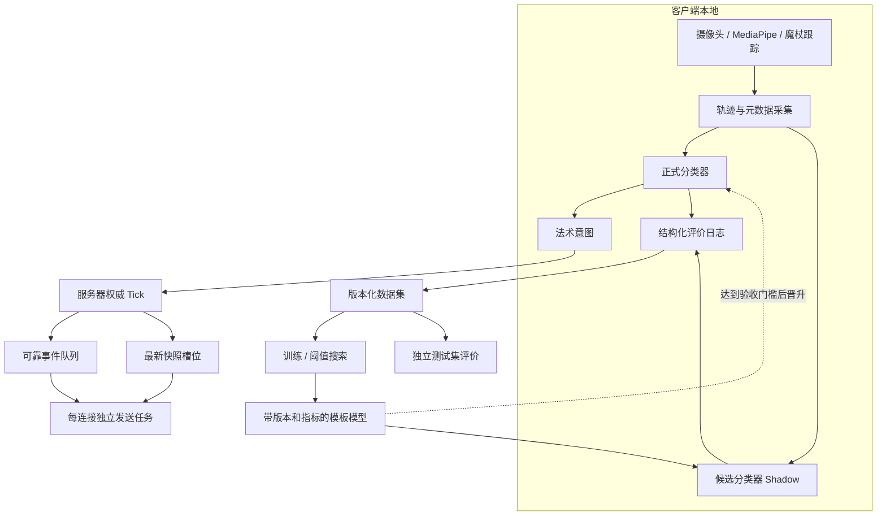

# Spells Battle 下一阶段优化策划案

状态：待实施  
范围：可测量识别系统、圆形/模板匹配、服务器 Tick 与发送解耦  
架构前提：CV 识别继续在客户端本地执行，服务器继续负责权威战斗结算

## 1. 背景与结论

当前项目已经具备完整的本地 CV 管线、远程房间、服务器权威战斗、状态快照和断线重连。本阶段不再扩展玩法，而是提高三个核心系统的可证明性与稳定性：

1. 将识别优化从“凭手感调阈值”升级为可复现、可比较、可验收的实验流程；
2. 解决闭合圆形轨迹对起点敏感的问题，并完善模板分类的歧义判断；
3. 将服务器固定 Tick 与 WebSocket 发送解耦，使慢连接不能拖慢全部房间。

客户端仍只向服务器发送法术意图。摄像头画面、MediaPipe 关键点、魔杖检测和轨迹分类均不上传。服务器不运行 MediaPipe，也不在本阶段增加反作弊轨迹验证。

## 2. 本阶段目标

### 2.1 识别系统目标

- 每次分类算法或阈值变更都有固定数据集和基线报告；
- 支持按法术、输入模式、用户、设备和录制批次查看指标；
- 输出准确率、Macro-F1、拒识率、误识率、混淆矩阵和推理耗时；
- 区分训练集、验证集和测试集，禁止用测试集调阈值；
- 新算法先以 shadow 方式运行，通过验收门槛后才影响正式施法；
- 将分辨率相关的像素特征逐步转为手掌尺度或画面尺度归一化特征。

### 2.2 圆形与模板匹配目标

- Stupefy 圆形识别对绘制起点不敏感；
- 是否允许反向匹配由显式配置控制，不能意外破坏方向型法术；
- DTW 输出 Top-1、Top-2、距离和 margin；
- margin 太小时返回 ambiguous，而不是强行给出高置信度结果；
- 循环 DTW 仅用于经过闭合判定的 Stupefy 轨迹和模板；
- Incendio、Glacius、Lumos 和 Overload 保留方向语义。

### 2.3 服务器解耦目标

- 战斗 Tick 不直接等待任何 WebSocket `send()`；
- 每个连接拥有独立发送任务；
- 可靠消息保持顺序且不静默丢失；
- `battle_snapshot` 只保留最新一份，旧快照可以被覆盖；
- 慢客户端不能无限占用内存，也不能拖慢其他房间；
- 发送异常、连接关闭和服务器停机均能正确清理后台任务。

## 3. 非目标

本阶段明确不做：

- 不把 MediaPipe 或 DTW 移到服务器；
- 不上传摄像头画面或原始手部关键点；
- 不实现反作弊；
- 不增加新法术，不调整魔力、伤害和冷却；
- 不重做魔杖颜色检测；
- 不用神经网络直接替换现有分类器；
- 不因为训练集结果较好就立即修改正式施法逻辑；
- 不将发送队列实现为无上限队列。

## 4. 当前基线

### 4.1 已有能力

- `cv/gesture_classifier.py`：规则特征与法术匹配；
- `cv/template_classifier.py`：轨迹重采样、归一化和 DTW；
- `cv/gesture_pipeline.py`：规则分类与数据模板融合；
- `game/cv_training.py`：Mode 4 标注与模板槽位；
- `tools/train_gesture_templates.py`：k-medoids 原型训练；
- `tools/evaluate_gesture_templates.py`：初步离线评价；
- `tools/replay_cv_logs.py`：日志重放；
- `server/app.py`：固定 Tick、事件和快照广播；
- `server/connection.py`：单连接发送封装。

### 4.2 已知限制

- 旧日志没有稳定的 `user_id`、`device_id`、分辨率和手掌尺度元数据；
- 评价工具以单文件和留一模板比较为主，尚未形成严格的数据划分；
- 当前多数规则使用像素距离，跨分辨率和拍摄距离泛化有限；
- 普通 DTW 固定比较轨迹第 0 点，圆形起点变化会增大距离；
- 当前置信度是决策分数，不是经过校准的真实正确概率；
- 绘制过程预览使用裸 heuristic，停止后的正式判定使用融合 pipeline，可能出现预览与结果不一致；
- Tick 循环内直接等待广播，慢连接可能形成网络背压。

### 4.3 现有数据盘点与使用规则

截至基线提交 `d547b00` 后的首次盘点，仓库已有：

- `logs/cv_sessions/`：178 个 JSONL 会话文件，共 2869 条记录；其中 75 条为带 `intended_spell` 的训练记录；
- `models/gesture_template_bank.json`：每类 30 个槽位，共 77 条含有效轨迹的槽位；分布为 Incendio 28、Circle 11、Glacius 12、Lumos 14、Overload 12；
- `models/gesture_reviewed_samples.jsonl`：86 条人工审核记录，其中 27 条 accepted、59 条 discarded；
- `models/gesture_templates.json`：由现有数据训练得到的 5 类、每类 3 个 prototype 模型。

这批数据必须继续使用，但四种文件承担不同职责：

1. 原始会话日志是不可变来源和候选样本池，不能因为当前分类器预测正确就自动当作真值；
2. 人工审核日志是标签和接受/丢弃的审计层；同一 `sample_id` 以最后一次审核为准；
3. 模板 Bank 是当前人工维护的可用样本视图；
4. `gesture_templates.json` 是训练产物，不能反过来当作训练数据。

盘点确认：27 条 accepted 审核样本已经全部存在于模板 Bank 中。因此训练器不得把 Bank 和 reviewed accepted 简单拼接，否则会重复加权同一批样本。Phase 0/1 必须先建立 canonical sample registry：

```text
raw log sample
    + latest review overlay
    + current bank membership
    -> canonical sample_id
    -> one trajectory, one label, one split assignment
```

去重优先级：

- 首选显式 `sample_id`；
- 旧 Bank 条目没有 `sample_id` 时，使用规范化的 `source_file + source_attempt_id`；
- 仍缺少 attempt 时，使用来源文件、标签和归一化轨迹摘要生成稳定 legacy ID；
- 不允许仅依靠数组位置或本次运行顺序生成 ID；
- 报告必须列出重复、冲突标签、缺失来源和被丢弃数量。

现有 77 条有效 Bank 轨迹可立即用于：

- 锁定当前 heuristic/template/fused 基线；
- 训练第一版 k-medoids prototype；
- 对循环 DTW 做前后配对比较；
- 建立固定小型回归夹具；
- 发现 Circle 起点敏感、margin 过小和常见混淆样本。

但它们多数缺少可靠 `user_id`、`device_id` 和 `palm_scale`，不能用来证明跨用户或跨设备泛化。现有数据先标记为 `legacy`，尽可能依据 `source_file` 做 session split；新 Schema v2 数据再用于严格的 user/device split。

Circle 当前只有 11 条有效 Bank 轨迹，足够开发和验证循环位移实现，但不足以单独支撑强泛化结论。可以将真实 Circle 轨迹循环改变起点作为算法不变性测试，但这些派生轨迹必须与原轨迹处于同一数据分区，不能被当作独立测试样本扩大样本数。

## 5. 目标架构



## 6. 工作包 A：可测量识别系统

### A0. 锁定基线

在任何算法修改之前：

- 保存当前模型、配置和测试结果；
- 对现有已审核样本运行 heuristic、template、fused 三种分类；
- 输出首份基线 JSON 与 Markdown 报告；
- 报告必须记录 Git commit、模型版本、数据集版本和执行命令。

基线不能因结果不好而删除或覆盖。后续报告必须可以与它并排比较。

### A1. 日志与数据集 Schema v2

在保持读取 v1 日志能力的前提下，为新采集样本增加：

```json
{
  "schema": 2,
  "sample_id": "uuid",
  "session_id": "session identifier",
  "user_id": "anonymous local label",
  "device_id": "anonymous device label",
  "input_mode": "finger or wand",
  "frame_width": 1280,
  "frame_height": 720,
  "fps_estimate": 59.8,
  "palm_scale": 134.2,
  "intended_spell": "circle",
  "points": [[100.0, 200.0]],
  "review_status": "accepted",
  "classifier_version": "identifier"
}
```

约束：

- `user_id` 和 `device_id` 只使用用户自己填写的匿名标签；
- 不写入姓名、摄像头画面或系统硬件序列号；
- 旧样本缺失元数据时标为 `legacy`，不能伪造用户独立划分；
- 同一个样本的后续人工审核以 `sample_id` 合并，最后一次审核结果生效。

### A2. 数据划分

评价工具至少支持三种划分：

1. `session_split`：按录制会话划分，避免相邻轨迹泄漏；
2. `user_split`：按用户留出测试，衡量跨用户泛化；
3. `device_split`：按设备留出测试，衡量跨摄像头泛化。

默认比例：训练 60%、验证 20%、测试 20%。样本不足时不伪造百分比，报告应明确显示“不足以形成可靠测试集”。

### A3. 指标与报告

统一评价输出：

- 总体 Accuracy；
- Macro Precision、Recall、F1；
- 每个法术 Precision、Recall、F1；
- `no match` 拒识率；
- 错误接受率；
- 混淆矩阵；
- Top-1 与 Top-2 margin 分布；
- 每条轨迹推理耗时以及 p50、p95；
- 按 `finger/wand`、用户、设备、会话分组的指标；
- 相对上一基线的变化值。

产物建议：

```text
artifacts/cv_evaluation/<run_id>/
    manifest.json
    metrics.json
    report.md
    confusion_matrix.csv
    misses.jsonl
```

`artifacts/` 默认不提交大型运行结果；仓库只保留一份小型、可重复生成的示例报告和报告格式说明。

### A4. 尺度归一化 Shadow

新增版本化特征提取，不直接覆盖旧特征：

- 距离和跨度优先除以 `palm_scale`；
- 无手掌尺度的旧样本使用画面对角线或轨迹尺度 fallback，并在报告中单列；
- 时间特征基于实际时间戳或 FPS，不假设固定帧率；
- 保留方向，禁止对所有法术做旋转不变归一化；
- 旧分类器作为 Baseline，新分类器作为 Shadow 同时运行。

只有通过第 9 节验收门槛后，才允许归一化特征进入正式分类器。

### A5. 统一预览与最终分类接口

预览和最终识别必须使用相同的分类 pipeline 和模型版本。预览可以：

- 降低运行频率，例如每 3 至 5 帧计算一次；
- 只显示候选，不触发施法；
- 使用连续多次一致结果稳定 UI；
- 缓存轨迹前缀特征，避免重复计算全部历史。

不得继续让 UI 预览显示 heuristic 结果、最终施法却使用 fused 结果。

## 7. 工作包 B：圆形与模板匹配

### B1. DTW 结果结构化

模板分类结果扩展为：

```text
spell
confidence
best_distance
second_spell
second_distance
margin
ambiguous
matched_prototype_id
algorithm_version
```

融合层不应从人类可读 `reason` 字符串反解析数据。

### B2. 闭合轨迹判定

循环 DTW 启用前必须通过闭合门：

- 原始点数达到最低要求；
- 路径长度达到最低要求；
- 起终点距离 / 路径长度低于阈值；
- x/y 跨度达到最低要求；
- 圆形面积和圆度没有明显退化。

闭合门参数必须由验证集确定，不能直接根据测试集结果调参。

### B3. 循环 DTW

对 32 点 Stupefy 模板依次循环移动起点，计算：

```text
min(DTW(input, roll(template, shift)))
```

实现约束：

- 默认检查全部 32 个 shift；
- 只对 Stupefy 使用；
- 反向序列是否参与比较由配置控制并写入模型 manifest；
- 返回最佳 shift，便于调试；
- 保持原 `_dtw_distance()` 作为普通方向型匹配路径；
- 增加缓存，避免同一轨迹在训练、阈值搜索和报告阶段重复计算。

### B4. 模板与阈值训练

在现有 k-medoids 基础上增加：

- 每类独立阈值；
- 基于验证集的阈值搜索；
- Top-1/Top-2 margin 阈值；
- 离群样本报告；
- prototype ID 和来源追踪；
- 模型 schema 版本；
- 训练集/验证集摘要；
- 训练命令和 Git commit。

训练过程不得使用测试集选择 k、距离阈值或 margin。

### B5. Shadow、晋升与回退

新圆形分类先进入 Shadow：

- 正式施法保持旧结果；
- 日志同时记录旧结果和循环 DTW 结果；
- 离线报告比较 Stupefy Recall、错误接受率和整体 Macro-F1；
- 达标后通过单一配置切换晋升；
- 保留旧模型和一键回退能力。

## 8. 工作包 C：服务器 Tick 与发送解耦

### C1. 消息类别

消息分为两类：

可靠有序消息：

- `room_created`、`room_joined`、`room_state`；
- `battle_event`；
- `error`、`pong` 和连接控制消息。

可合并状态消息：

- `battle_snapshot`。

可靠消息进入有界 FIFO；快照进入 `latest_snapshot` 单槽位。新快照覆盖尚未发送的旧快照，并累计 `coalesced_snapshot_count`。

### C2. 每连接发送器

每个连接包含：

```text
bounded reliable queue
latest snapshot slot
wakeup event
sender task
closing flag
send statistics
```

发送任务策略：

1. 优先保持可靠消息顺序；
2. 每处理有限数量可靠消息后检查最新快照，避免快照永久饥饿；
3. WebSocket 发送设置超时；
4. 可靠队列满或连续发送超时时关闭慢连接；
5. 关闭时取消 sender task，并吞吐完结事件，不泄漏任务。

### C3. Tick 循环改造

`BattleServer._tick_loop()` 只允许：

- 推进权威战斗；
- 产生事件和快照；
- 将消息同步写入内存队列；
- 记录 Tick 延迟。

Tick 循环内不得出现等待真实网络发送完成的 `await websocket.send(...)`。向队列投递必须是有界且快速的操作。

### C4. 背压与慢客户端策略

- 可靠队列建议初始上限 256 条；
- 快照永远最多积压 1 条；
- 队列满后不得静默丢弃 `round_ended` 等可靠事件；
- 慢连接应收到明确日志并被断开；
- 另一玩家进入现有断线暂停/重连流程；
- 断开慢连接不能关闭整个房间或影响其他房间。

### C5. 可观测性

新增结构化指标或日志字段：

- `tick_duration_ms`、`tick_lag_ms`；
- 每连接可靠队列深度；
- 快照合并数量；
- 发送耗时 p50/p95；
- 发送超时和发送失败数量；
- 因背压断开的连接数量。

不得在日志中写入 reconnect token、摄像头信息或轨迹数据。

## 9. 验收门槛

### 9.1 工作包 A 验收

- 同一数据集、模型和 commit 重复运行得到相同指标；
- 报告包含样本数量和数据划分，空数据或数据不足时明确失败；
- 训练、验证、测试之间不存在相同 `sample_id`；
- `user_split` 不允许同一用户同时出现在训练和测试；
- 所有旧日志仍能读取；
- 评价工具有固定的小型测试夹具；
- 正式分类结果在 Shadow 阶段保持不变。

### 9.2 工作包 B 晋升门槛

只有同时满足以下条件，循环 DTW 才能进入正式 Stupefy 判断：

- 独立测试集 Stupefy Recall 至少提升 5 个百分点，或错误接受数量至少下降 20%；
- 整体 Macro-F1 下降不超过 1 个百分点；
- 其他单个法术 Recall 下降不超过 2 个百分点；
- 推理 p95 满足实时预算；建议单次最终分类低于 10ms；
- 至少包含多个录制会话；若要声称跨用户泛化，测试集必须包含未参与训练的用户；
- 自动测试、日志回放和人工冒烟均通过。

样本不足时只能保留 Shadow，不得为了完成任务降低门槛。

### 9.3 工作包 C 验收

- 模拟一个 `send()` 长时间阻塞的客户端，服务器 Tick 仍维持目标频率；
- 快照积压不超过 1；
- 可靠事件顺序保持一致；
- 可靠队列满时连接被明确断开而不是无限增长；
- 慢连接不影响另一个房间的正常消息；
- 重连、停服、客户端主动关闭均无遗留 sender task；
- 现有服务器集成、鲁棒性、房间和公网探针测试继续通过。

## 10. 测试计划

### 10.1 CV 单元测试

- v1/v2 日志兼容；
- 归一化特征在不同分辨率下近似一致；
- 圆形不同起点得到接近距离；
- 方向型法术不使用循环 DTW；
- 顺/逆时针配置生效；
- Top-2 margin 与 ambiguous 判断；
- 数据划分无泄漏；
- 训练不读取测试集；
- 预览和最终分类使用同一 pipeline 版本。

### 10.2 CV 评价回归

- 固定小型数据集的指标快照；
- 基线与候选报告差异测试；
- 空标签、坏 JSON、重复审核和缺失元数据；
- 不足样本必须返回非零退出码或明确不可晋升状态。

### 10.3 服务器异步测试

- 正常发送顺序；
- 慢 `send()` 不阻塞 Tick；
- 快照覆盖；
- 可靠队列溢出；
- sender task 取消和关闭；
- WebSocket 异常；
- 两个房间中一个慢客户端的隔离；
- 断线暂停和重连兼容。

### 10.4 完整回归

每个阶段至少运行：

```powershell
python -m unittest discover -s tests -v
python -m compileall -q main.py cv game network server tools
```

算法晋升前还必须运行固定数据集评价命令，并把报告路径和结果写入交付说明。

## 11. 实施阶段与提交顺序

### Phase 0：基线和护栏

- 生成现状指标；
- 增加版本 manifest；
- 冻结正式分类行为测试。

建议提交：`test: lock gesture evaluation baseline`

### Phase 1：Schema v2 与严格评价

- 扩展日志；
- 实现数据划分和指标；
- 输出 JSON、Markdown 和 CSV 报告。

建议提交：`feat: add reproducible gesture evaluation`

### Phase 2：尺度归一化 Shadow 与统一 pipeline

- 新特征并行计算；
- 预览和最终分类共享接口；
- 正式施法仍使用基线结果。

建议提交：`feat: evaluate normalized gesture features in shadow mode`

### Phase 3：圆形循环 DTW

- 结构化 DTW 输出；
- 闭合门；
- 循环位移；
- margin 与歧义拒绝；
- 训练和评价升级。

建议提交：`feat: add cyclic DTW for closed gestures`

### Phase 4：数据验收与按法术晋升

- 收集足够真实样本；
- 运行独立测试集；
- 仅在达标时晋升 Stupefy；
- 保留配置回退。

建议提交：`feat: promote validated Stupefy classifier`

如果未达到指标，本 Phase 的正确结果是保留 Shadow 和报告原因，而不是强行上线。

### Phase 5：服务器发送解耦

- 每连接 sender；
- 可靠队列；
- 最新快照槽；
- 背压和清理；
- Tick/队列观测。

建议提交：`refactor: decouple server ticks from websocket sends`

### Phase 6：整体验收

- 完整自动化测试；
- 双客户端本地联机；
- 阿里云两台真实设备验收；
- 模拟慢客户端；
- 更新运行手册和项目状态。

建议提交：`docs: record optimization acceptance results`

## 12. 风险与回退

| 风险 | 控制方式 | 回退方式 |
|---|---|---|
| 新数据量不足 | 报告明确不可晋升 | 保留 Shadow |
| 旧日志缺元数据 | 单列 legacy | 不用于跨用户结论 |
| 循环 DTW 误收其他闭合乱画 | 闭合门、margin、独立测试 | 关闭 cyclic 配置 |
| DTW 每帧预览过慢 | 降低预览频率、缓存 | 预览只显示 heuristic，但 UI 必须标注；最终仍统一版本 |
| 归一化破坏方向型法术 | 按法术启用、保留方向 | 切回 Baseline feature version |
| 发送队列无限增长 | 有界队列、最新快照覆盖 | 慢连接断开 |
| 可靠事件丢失 | FIFO、溢出断开、顺序测试 | 恢复原发送路径 |
| sender task 泄漏 | 统一生命周期和取消测试 | 功能开关切回同步发送 |

## 13. 完成定义

本策划案完成不能只以“代码写完”为准，必须同时满足：

1. 有可复现的现状基线和候选算法报告；
2. 新数据 Schema 与旧数据兼容；
3. 数据划分无明显泄漏；
4. 圆形起点不敏感有单元测试和真实数据指标支持；
5. 未达到晋升门槛的算法仍停留在 Shadow；
6. 服务器 Tick 不等待真实 WebSocket 发送；
7. 慢客户端不会导致全局 Tick 下降或无限内存增长；
8. 现有完整自动化测试全部通过；
9. 两台真实设备通过阿里云公网对战验收；
10. 交付说明包含修改摘要、指标、测试结果、已知风险和回退方式。

## 14. 可直接发布的 Goal 指令

```text
请严格依据 docs/next_optimization_plan.md 实施 Spells Battle 下一阶段优化，不得绕过该文档的 Shadow、数据划分、晋升门槛、背压和完成定义。

目标包括三个工作包：
1. 建立可复现的手势识别测量体系：兼容旧日志，引入 Schema v2、严格训练/验证/测试划分、按用户/设备/会话评价、混淆矩阵、Macro-F1、拒识率、误识率、margin 和耗时报告；像素特征的尺度归一化必须先以 Shadow 运行。
2. 改进圆形与模板匹配：为经过闭合判定的 Stupefy 实现循环位移 DTW、结构化 Top-1/Top-2 距离和 margin、ambiguous 拒绝、模型版本和独立阈值；不得对方向型法术无条件启用循环或旋转不变；只有满足策划案晋升门槛后才能影响正式施法。
3. 解耦服务器固定 Tick 与 WebSocket 发送：每连接使用有界可靠 FIFO、最新快照单槽位和独立 sender task；可靠事件不得静默丢失，旧快照允许覆盖，慢连接必须隔离并有明确断开策略，所有任务必须正确清理。

架构硬约束：
- MediaPipe、魔杖跟踪、轨迹和法术分类继续在客户端本地执行；
- 服务器继续权威校验玩家身份、房间、冷却、魔力、序列号和战斗结果；
- 不上传摄像头画面，不实现反作弊，不调整玩法数值，不增加法术，不重做美术；
- 不得使用测试集调参；样本不足或指标不达标时，候选算法必须保持 Shadow；
- 不得创建无限发送队列；Tick 循环不得等待真实 websocket.send；
- 保持旧模型和旧日志兼容，所有晋升都必须可配置回退。

按策划案 Phase 0 至 Phase 6 顺序工作，每一阶段先补测试再完成实现，保持提交粒度清晰。每次交付必须报告：修改文件、架构影响、数据集与模型版本、指标对比、测试命令和结果、剩余风险、是否达到晋升门槛。最终必须运行完整 unittest 与 compileall，并完成慢客户端隔离测试和两台真实设备公网验收。不能仅以单元测试通过宣称整个 Goal 完成。
```
